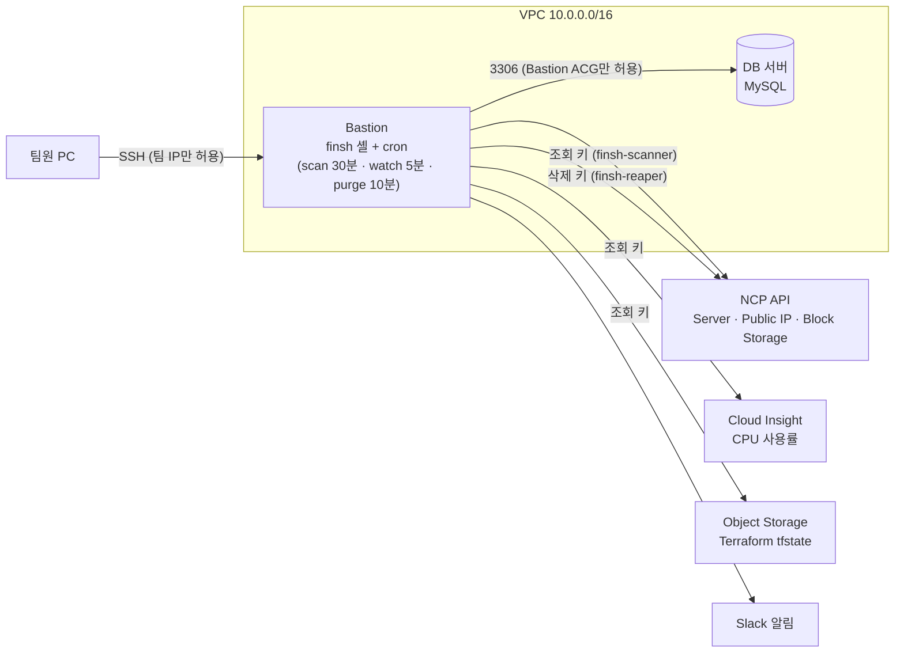

# finsh

# finsh

> 네이버 클라우드에서 **모르는 사이 새고 있는 돈**을 찾아 정리하는 FinOps 셸

서버를 지워도 공인 IP는 남아 있고, 실습이 끝난 서버는 정지만 해둔 채 잊힙니다.
finsh는 이런 방치 자원을 주기적으로 찾아 요금과 함께 보여주고, 리눅스 명령어처럼 익숙한 방식(`top`, `kill`, `chattr`)으로 안전하게 정리할 수 있게 해줍니다.

- **대상**: NCP를 쓰는 소규모 팀, 1인 개발자, 실습 학생
- **사용 방법**: Bastion 서버에 접속해서 `finsh` 한 줄이면 됩니다. 사용자가 클라우드 키를 몰라도 됩니다.

---

## 주요 기능

| 기능 | 설명 |
|---|---|
| 방치 자원 탐지 | 30분마다 서버, 공인 IP, 블록 스토리지를 스캔해서 정리 후보를 판정합니다 |
| 요금 계산 | 자원별 시간당 요금과 방치 기간 동안 쌓인 요금을 보여줍니다 |
| 안전한 삭제 | `kill`은 바로 지우지 않고 휴지통에 넣습니다. 3영업일 뒤 삭제되며, 그 사이 복원할 수 있습니다 |
| 재사용 감지 | 휴지통에 있는 자원이 다시 쓰이면 삭제를 자동으로 멈춥니다 |
| 보호 | 사람이 `chattr +i`로 보호하거나, Terraform으로 만든 자원은 영구 보호됩니다 |
| 알림 | 삭제 1영업일 전, 삭제 완료, 삭제 보류 시 Slack과 셸 화면으로 알립니다 |

### 판정 기준

| 판정 | 기준 | `top`에 표시 |
|---|---|:---:|
| `ORPHAN` | 서버에 연결되지 않은 공인 IP, 서버에서 분리된 추가 블록 스토리지 | O |
| `ZOMBIE` | 7일 이상 정지 상태로 관측된 서버 | O |
| `IDLE` | 7일간 실행 중이며 CPU 평균 5% 미만인 서버 | O |
| `WAITING` | 정지 관측 7일 미만인 서버 | 요약만 |
| `UNKNOWN` | API 오류, 작업 중, 관측 공백, CPU 데이터 부족 | 요약만 |
| `OK` | 정상 | X |

방치 기간은 **finsh가 직접 연속으로 관측한 시간**만 셉니다. 확인하지 못한 시간을 방치로 단정하지 않기 위해서입니다. 관측이 90분 넘게 끊기면 다시 0부터 셉니다.

자세한 규칙은 [`docs/conventions.md`](docs/conventions.md)를 참고하세요.

---

## 명령어

| 명령어 | 설명 |
|---|---|
| `top` | 정리 후보 목록과 요금 요약 |
| `stat <ID>` | 자원 하나의 상세 정보 (판정 이유, CPU, 보호 상태) |
| `kill <ID>` | 휴지통에 넣기 (기한이 지나면 자동 삭제) |
| `sudo kill -9 <ID>` | 휴지통 없이 바로 삭제 (ID를 한 번 더 입력해야 실행) |
| `trash-list` | 휴지통 목록 |
| `trash-restore <ID>` | 휴지통에서 꺼내기 |
| `chattr +i <ID> -m "이유"` | 보호하기 (기본 30일) |
| `chattr -i <ID>` | 보호 풀기 (Terraform 자원은 불가) |
| `lsattr` | 보호 중인 자원 목록 |
| `last` | 최근 작업 기록 |
| `help`, `exit` | 도움말, 종료 |

ID는 앞부분만 입력해도 됩니다 (예: `ip-526a` → `ip-5`).

---

## 아키텍처



### 안전장치

삭제는 아래 조건을 **모두** 통과해야 실행됩니다.

1. Terraform 관리 자원이 아닐 것 (tfstate를 못 읽으면 판정 불가로 보고 삭제를 막습니다)
2. `chattr +i`로 보호 중이 아닐 것
3. `settings.yaml`의 `never_touch`에 없고, 허용된 이름(`allowed_name_prefix`)이거나 허용된 번호(`allowed_ncp_no`)일 것
4. 최근 스캔에서 정리 후보로 판정됐고, 그 뒤로 상태가 바뀌지 않았을 것
5. 연습 모드(`FINSH_DRY_RUN=1`)가 아닐 것
6. 실제 삭제 승인 목록(`FINSH_REAPER_APPROVED_NCP_NOS`)에 있을 것

조회 키(scanner)와 삭제 키(reaper)를 다른 서브계정으로 분리해서, 조회 키가 유출돼도 자원을 지울 수 없습니다.

---

## 설치 가이드 (새 NCP 계정에 처음 도입할 때)

설치는 관리자 1명이 한 번만 하면 됩니다. 이후 사용자는 Bastion에 접속해서 `finsh`만 입력하면 됩니다.

### 0. 준비물

- [ ] NCP 계정과 Object Storage 버킷 1개 (Terraform 상태 저장용)
- [ ] Terraform 1.10 이상 (`backend.tf`의 `use_lockfile` 사용)
- [ ] 서브계정 2개 (Sub Account → 서브 계정, 접근 유형은 **API Gateway만** 체크)

| 서브계정 | 관리형 정책 | 용도 |
|---|---|---|
| `finsh-scanner` | `NCP_VPC_SERVER_VIEWER`, `NCP_CLOUD_INSIGHT_VIEWER`, `NCP_OBJECT_STORAGE_VIEWER` | 자원·CPU 조회, tfstate 읽기 |
| `finsh-reaper` | `NCP_VPC_SERVER_MANAGER` | 실제 삭제 (실제 삭제할 때만 필요) |

- [ ] (선택) Slack Incoming Webhook URL

### 1. 코드 받기

```bash
git clone https://github.com/Cloud-Literacy-team-project/finsh.git
cd finsh
```

### 2. 인프라 만들기 (Terraform)

`infra/core`는 VPC, 서브넷, ACG, Bastion, DB 서버, 공인 IP를 만듭니다.

```powershell
cd infra/core
# backend.tf의 bucket 이름을 내 버킷으로 바꾼다
Copy-Item terraform.tfvars.example terraform.tfvars
# terraform.tfvars의 team_ips에 팀원 공인 IP를 "x.x.x.x/32" 형식으로 넣는다
./load-env.ps1          # 프로젝트 루트 .env의 NCLOUD 키를 Terraform에 전달
terraform init
terraform plan
terraform apply
```

> SSH를 `0.0.0.0/0`으로 열지 마세요. `team_ips`가 비어 있으면 외부 SSH가 막힌 상태로 생성됩니다.

### 3. DB 서버 준비

DB 서버에 접속해서 MySQL을 설치하고, Bastion에서만 접속할 수 있는 사용자를 만듭니다.

```bash
sudo apt update && sudo apt install -y mysql-server
# /etc/mysql/mysql.conf.d/mysqld.cnf 의 bind-address 를 DB 사설 IP로 변경 후
sudo systemctl restart mysql
sudo mysql
```

```sql
CREATE DATABASE finsh CHARACTER SET utf8mb4;
CREATE USER 'finsh'@'10.0.1.%' IDENTIFIED BY '<강한 비밀번호>';
GRANT ALL PRIVILEGES ON finsh.* TO 'finsh'@'10.0.1.%';
```

### 4. Bastion에 배포

```bash
sudo apt update && sudo apt install -y python3-venv cron util-linux
sudo adduser --disabled-password --gecos "" finsh
sudo mkdir -p /opt/finsh && sudo chown finsh:finsh /opt/finsh
sudo -u finsh git clone https://github.com/Cloud-Literacy-team-project/finsh.git /opt/finsh
cd /opt/finsh
sudo -u finsh python3 -m venv .venv
sudo -u finsh .venv/bin/pip install -r requirements.txt
sudo -u finsh cp .env.example .env
```

### 5. `.env` 채우기 (`/opt/finsh/.env`)

```bash
NCLOUD_ACCESS_KEY=        # finsh-scanner 키
NCLOUD_SECRET_KEY=
FINSH_SCANNER_ACCESS_KEY= # finsh-scanner 키 (같은 값)
FINSH_SCANNER_SECRET_KEY=
FINSH_TFSTATE_BUCKET=     # 2단계의 버킷 이름

FINSH_DB_HOST=            # DB 서버 사설 IP
FINSH_DB_PORT=3306
FINSH_DB_USER=finsh
FINSH_DB_NAME=finsh
FINSH_DB_PASSWORD=

FINSH_SOURCE=db
FINSH_DRY_RUN=1           # 처음에는 반드시 연습 모드

SLACK_WEBHOOK_URL=        # 선택
```

```bash
sudo chmod 600 /opt/finsh/.env && sudo chown finsh:finsh /opt/finsh/.env
```

### 6. 내 계정에 맞게 `config/settings.yaml` 수정

| 항목 | 설명 |
|---|---|
| `scan_name_prefix` | 이 이름으로 시작하는 자원만 스캔. 비우면 계정 전체 |
| `tfstate_bucket` | Terraform 상태 버킷 |
| `never_touch` | 어떤 경우에도 건드리지 않을 자원 이름 (Bastion, DB 서버 이름) |
| `allowed_name_prefix`, `allowed_ncp_no` | 삭제를 허용할 이름 접두사, 자원 번호 |

### 7. DB 초기화와 자동 실행 등록

```bash
cd /opt/finsh
sudo -u finsh .venv/bin/python -m db.init          # 테이블 생성 (여러 번 실행해도 안전)
sudo -u finsh .venv/bin/python -m jobs.run_scan    # 첫 스캔
sudo bash infra/bastion/install.sh                 # finsh 명령어와 cron 등록
```

`install.sh`는 연습 모드, DB 연결, Terraform 기록 읽기를 확인한 뒤 `/usr/local/bin/finsh`와 `/etc/cron.d/finsh`를 설치합니다. 여러 번 실행해도 안전합니다.

### 8. 확인

```bash
finsh                       # top, lsattr 확인
ls /var/log/finsh/          # scan.log, watch.log, purge.log 가 쌓이는지
```

### 9. 실제 삭제 켜기 (선택)

연습 모드로 충분히 확인한 뒤에만 켜세요.

```bash
FINSH_REAPER_ACCESS_KEY=          # finsh-reaper 키
FINSH_REAPER_SECRET_KEY=
FINSH_REAPER_APPROVED_NCP_NOS=    # 실제로 지워도 되는 자원 번호, 쉼표로 구분
FINSH_DRY_RUN=0
```

---

## 설정

### 환경변수 (`.env`)

| 변수 | 필수 | 설명 | 읽는 위치 |
|---|:---:|---|---|
| `NCLOUD_ACCESS_KEY`, `NCLOUD_SECRET_KEY` | O | 스캔용 키 | `ncp/api.py` |
| `FINSH_SCANNER_ACCESS_KEY`, `..._SECRET_KEY` | | tfstate 읽기용 키 (없으면 NCLOUD 키 사용) | `engine/iac.py` |
| `FINSH_REAPER_ACCESS_KEY`, `..._SECRET_KEY` | | 삭제용 키 | `ncp/api.py`, `engine/killer.py` |
| `FINSH_REAPER_APPROVED_NCP_NOS` | | 실제 삭제 승인 자원 번호 | `engine/killer.py` |
| `FINSH_DB_HOST`, `FINSH_DB_PASSWORD` | O | DB 접속 정보 | `db/database.py` |
| `FINSH_DB_PORT`, `FINSH_DB_USER`, `FINSH_DB_NAME` | | 기본값 3306, finsh, finsh | `db/database.py` |
| `FINSH_TFSTATE_BUCKET` | | 없으면 `settings.yaml`의 값 사용 | `engine/iac.py` |
| `FINSH_SOURCE` | | `fake`(샘플 데이터, 기본) / `db`(실제) | `shell/data.py` |
| `FINSH_DRY_RUN` | | `0`일 때만 실제 삭제. 그 외는 연습 모드 | `engine/safety.py` |
| `SLACK_WEBHOOK_URL` | | Slack 알림 | `engine/notify.py` |
| `FINSH_LOG_DIR` | | 기본 `/var/log/finsh` (없으면 `logs/`) | `engine/scan.py` |

`.env`는 절대 Git에 올리지 마세요. `.env.example`에는 변수 이름만 적습니다.

### 판정·휴지통 설정 (`config/settings.yaml`)

| 항목 | 운영 기본값 | 시연 예시 |
|---|---|---|
| `zombie_days` | 7 | 0.005 (약 7분) |
| `idle_days` | 7 | 7 (시연에서는 바꾸지 않음) |
| `trash_wait` | `{unit: bizdays, value: 3}` | `{unit: minutes, value: 3}` |
| `notify_before` | `{unit: bizdays, value: 1}` | `{unit: minutes, value: 1}` |
| `observe_max_gap_minutes` | 90 | 90 |
| `protect_days` | 30 | 30 |

설정은 프로그램이 실행될 때마다 새로 읽으므로 재설치가 필요 없습니다. 이미 열려 있는 `finsh` 셸은 다시 실행하면 반영됩니다.

---

## 로컬 개발

```bash
python -m venv .venv
.venv/bin/pip install -r requirements.txt     # Windows: .venv\Scripts\pip
cp .env.example .env                           # FINSH_SOURCE=fake 면 키 없이 샘플 데이터로 실행
python finsh.py
python -m unittest discover -s tests -t .      # 테스트 99개
```

실제 DB에 붙으려면 SSH 터널을 엽니다 (로컬 MySQL과 겹치지 않게 3307 사용).

```bash
ssh -i <키 파일> -N -L 3307:<DB 사설 IP>:3306 finsh@<Bastion 공인 IP>
# .env: FINSH_DB_HOST=127.0.0.1, FINSH_DB_PORT=3307, FINSH_SOURCE=db
```

---

## 폴더 구조

```
finsh/
├── finsh.py            # 셸 진입점
├── shell/              # 명령어와 화면 (top, kill, chattr ...)
├── engine/             # 판정, 스캔, 휴지통, 삭제, 보호, 알림, 안전장치
├── ncp/                # NCP API 호출 (서버, 공인 IP, 블록 스토리지, Cloud Insight)
├── db/                 # MySQL 접속, 스키마, 마이그레이션
├── jobs/               # cron 작업 (run_scan, run_watch, run_purge)
├── config/             # settings.yaml, prices.yaml(단가표)
├── infra/core/         # Terraform: VPC, Bastion, DB
├── infra/test/         # Terraform: 보호 시연용 서버
├── infra/bastion/      # 설치 스크립트, cron, finsh 명령어
├── docs/               # 판정 규약, 통합 문서
└── tests/              # 단위·통합 테스트
```

---

## 교육 과정 연계

| 일차 | 주제 | finsh에서 사용한 곳 |
|---|---|---|
| 2일차 | 서버 | Bastion, DB 서버, 시연 서버 |
| 3일차 | 네트워크 | VPC, 서브넷, ACG (팀 IP만 SSH, Bastion만 DB 접근) |
| 4일차 | CLI·API | NCP API 서명 호출, Bastion 셸 |
| 5일차 | 스토리지 | 블록 스토리지 탐지, Object Storage(tfstate) |
| 7일차 | DB | MySQL에 자원·휴지통·보호·기록 저장 |
| 8일차 | 모니터링 | Cloud Insight CPU로 IDLE 판정, cron 로그, Slack 알림 |
| 9일차 | 보안 | Sub Account 최소 권한(조회/삭제 분리), `.env` 권한 600, 연습 모드 |

---

## 향후 과제

- GitHub Actions로 main 머지 시 Bastion 자동 배포
- 고정 API 키 대신 NCP 역할(Role) 기반 임시 자격증명
- 설치 단계를 스크립트 하나로 통합하고, 계정별 설정을 설치 중에 입력받기
- 야간·주말 자동 정지 스케줄러
